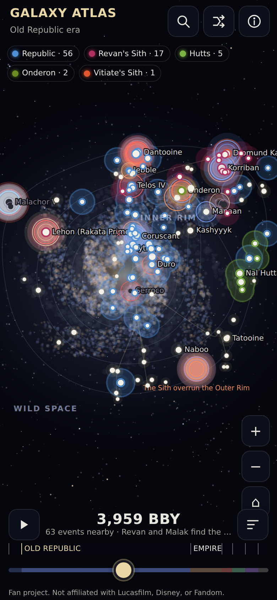
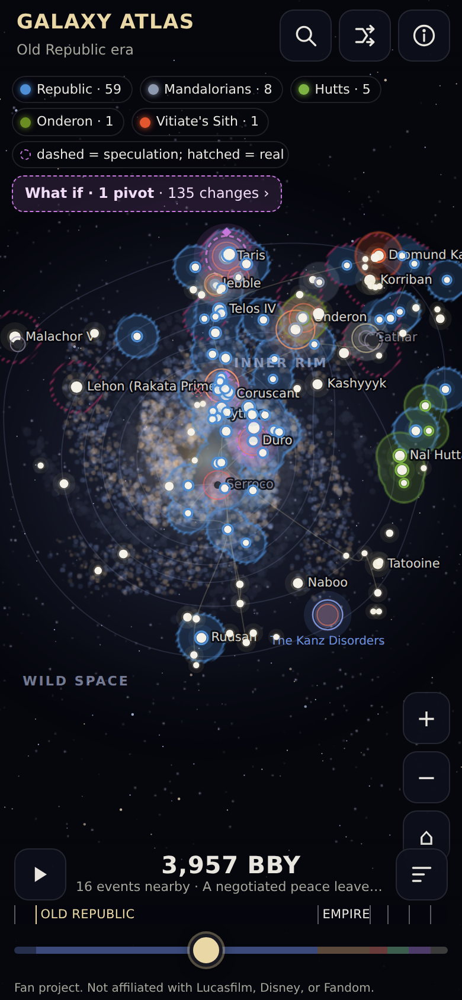
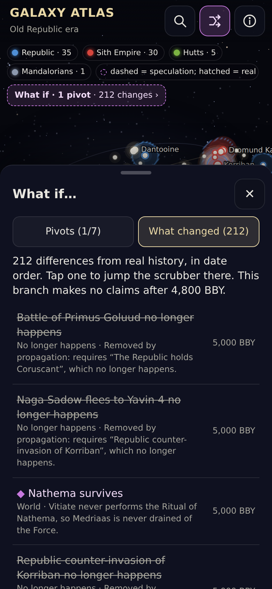

# Galaxy Atlas

A mobile-first, full-screen map of the Star Wars galaxy (Legends continuity) that you scrub
through time, watching faction territory, wars and events reshape it, then flip pivotal moments
of history and watch the galaxy re-form around the change.

Personal, non-commercial fan project. Not affiliated with Lucasfilm, Disney, or Fandom.

<p>
  
  
  
</p>

## Running it

```sh
npm install
npm run dev -- --host      # open the printed LAN URL on your phone over Wi-Fi
npm run build              # validates + builds data, type-checks, bundles to dist/
npm run preview            # serves dist/ at http://127.0.0.1:4173
```

Checks:

```sh
npm run validate:data      # schema, dates, grid squares, causal links, sources, counts
npm test                   # validate:data + Vitest (engine, time scale, every pivot)
npm run test:e2e           # Playwright at 390x844 (iPhone) and 412x915 (Pixel)
npm run lighthouse         # Lighthouse mobile against the built site
npm run screenshots        # phone screenshots of every era + three pivots -> docs/screenshots/
npm run fetch:wiki -- --all   # verify grid squares and source URLs against Wookieepedia (network)
```

Latest Lighthouse mobile run (`docs/lighthouse-summary.json`): performance 99, accessibility 100,
best practices 100, SEO 91.

### Showcasing it

The build is a static site with a relative base path, so `dist/` works from any sub-folder.
For GitHub Pages: build, publish `dist/` to a `gh-pages` branch (or point Pages at a folder
containing it), and the URL state (`#t=-3959&p=malak-betrayal-fails&s=taris`) makes individual
moments and what-ifs linkable. Nothing in this repository deploys anything on its own.

## What is in the box

| Count | Kind |
| --- | --- |
| 130 | star systems with galactic grid squares and regions |
| 260 | events (plus 7 "latent" events real history prevented) |
| 23 | factions |
| 49 | territory keyframes |
| 5 | major hyperlanes |
| 7 | hand-authored what-if pivots (see "Scope" below) |

The time scrubber runs from 37,000 BBY to 140 ABY across the seven Legends eras. Its scale is
piecewise: the Old Republic gets most of the thumb travel, and 5,100–3,500 BBY (the Old Republic
depth the project is about) gets more than a third of it.

## How the data was sourced

Everything in `data/` was researched against Wookieepedia's Legends articles and written in my
own words, two or three sentences per record. Every record carries a `source` URL to its
Wookieepedia page; the JSON Schema in `data/schema/` rejects records without one, and the
validator rejects any summary that contains wiki markup. No wiki text, images or map art is
copied: the galaxy, the region rings, the hyperlanes and every marker are drawn procedurally
from the coordinates in the data.

An honest caveat: the sandbox this was built in could not reach `starwars.fandom.com` (its
network policy denies the host), so the Wookieepedia API was never actually called during this
pass. Grid squares and dates were entered from Legends reference knowledge. Where I was not
confident of a grid square the system is flagged `gridUncertain: true` (a small dot after its
name at high zoom, and a note in its sheet); 85 of the 130 systems carry that flag. The script
`scripts/fetch-wookieepedia.mjs` exists to close that gap: it fetches at most one request per
second with a descriptive User-Agent, caches raw responses under the gitignored
`.cache/wookieepedia/`, checks every source URL resolves to a real page, and compares each
system's grid square with its infobox, writing `docs/verification-report.json`. It never edits
`data/`; corrections are applied by hand after reading the report. NOTES.md lists the specific
lore points I was unsure about.

### Data model

- `data/systems/*.json` — id, name, grid (`A-V` × `1-24`), region, importance, summary, source,
  optional `fate` (which event darkens the world, and until when).
- `data/factions.json` — id, name, short name, colour, era span, kind, summary, source.
- `data/events/*.json` — id, name, type, date (a year, or `{start, end, approx, uncertainty}`;
  negative is BBY), location (system or region), factions, summary, source, continuity, and
  causal links: `requires`, `enables`, `prevents`.
- `data/territory/base.json` — delta keyframes: at a date, which faction takes which systems
  or whole regions, which systems are released, which factions are suppressed. The build
  expands them into full snapshots; the app steps between snapshots and fades newly taken
  systems in over a few years.
- `data/pivots/*.json` — the what-ifs (below).
- `scripts/build-data.mjs` merges and validates all of it into `public/data/atlas.json`.

## How the counterfactual engine works

Events form a causal graph through their links. A pivot's branch names the event whose outcome
flips (its *divergence*), the events it removes directly, speculative events it adds, territory
overrides from the divergence date on, optional world fates, and a *horizon* after which the
branch makes no claims. Applying pivots (`src/engine/branch.ts`) is a pure function of the atlas
and the selected pivot ids, which is why toggling a pivot off restores real history exactly
(the tests check this for every pivot).

Propagation (`src/engine/causal.ts`):

- **requires** — if an event is removed, anything that transitively requires it is removed too,
  unless the branch lists it under `keep` with a reason. Removals are explained in the UI
  ("requires X, which no longer happens").
- **enables** — a looser link. Events a removed event merely *enabled* are not dropped and not
  silently kept: they get an **uncertain** badge, and uncertainty flows down `requires` links.
- **prevents** — points at a *latent* event: something lore says was poised to happen but real
  history prevented (the Sith taking Coruscant in 5,000 BBY, Darth Revan reclaiming the Star
  Forge). When every preventer is removed, the latent event appears, labelled speculation.
- **Territory** — overrides persist from their date onward, over later real keyframes, until a
  later override touches the same system. A branch can also `suppress` a faction's real holdings.
- **Fates** — if the event that destroyed a world no longer happens, the world stays lit.
- **Horizon** — real events after the branch's horizon are shown but badged uncertain, and the
  "What changed" list folds knock-on changes beyond it into a collapsed group.
- **Combining pivots** — all selected branches apply together (later-dated overrides win where
  they overlap). Conflicts are reported two ways: declared in the data, and derived when one
  pivot's propagation erases another pivot's divergence event. Both are explained in the panel.

Everything a branch adds or changes is drawn as speculation: violet, dashed, with a diamond
marker; "?" marks uncertain events; real history stays on the map as hatched ghost outlines.
Each pivot's premise cites the lore it leans on (the "details" button in the What-if panel).

## Map and rendering

Canvas 2D, no map library. The whole scene is a few hundred circles, a handful of paths and some
text, which Canvas 2D handles at 60 fps on a phone once the work is split sensibly; a WebGL
stack would have added bundle weight and a shader pipeline for no visible gain, and a tile-based
map library assumes a planet. The bundle is about 70 KB of JavaScript.

- Coordinates: world units are galactic grid squares (columns A–V, rows 1–24). A system sits in
  its square with a deterministic jitter so neighbours in the same square spread out.
- Region rings (Deep Core through Outer Rim) are derived from the data: for each angle the
  outer edge of a region is the furthest confident system labelled with that region or one
  inside it, smoothed around the circle. Unknown Regions and Wild Space are labelled, not ringed.
- Layers: a 1x galaxy background cached per camera state; grid, rings and lanes drawn per frame;
  faction territory as union-of-circles blobs composited in an offscreen layer (fill plus an
  outline band computed as dilated-minus-filled); event flares; systems and labels with
  collision avoidance and level of detail by zoom; and a separate 1x overlay canvas for the
  pulsing rings so the animation never redraws the scene.
- Progressive resolution: the first paint renders at 1x and the map switches to full device
  resolution on the first touch or after 3.5 s, which keeps the load free of long tasks.
- Gestures are pointer-event based: one finger pans, two fingers pinch-zoom around the midpoint,
  double-tap zooms, wheel zooms, arrow keys pan and `+`/`-` zoom when the map has focus.
- `prefers-reduced-motion` disables pulses, crossfades and camera flights.

## Mobile-first and accessibility

Designed at 390 px first. Every control is at least 44 px, sheets slide up from the bottom and
can be swiped away, there are no hover-only interactions, safe-area insets are respected and the
page never scrolls horizontally. The scrubber is a native range input with `aria-valuetext`;
sheets are dialogs with focus management and Escape; the map canvas has a descriptive, live
`aria-label` and keyboard navigation, and a Find sheet reaches every system without the canvas.

## Scope and deviations from SPEC.md

- **Pivots 1–7 only.** At the owner's request this pass goes deep from the Pre-Republic era to
  Darth Bane's death on Ambria (980 BBY). Later eras have anchor events and territory so the
  scrubber covers 140 ABY, but pivots 8–10 (Order 66 fails, the Rebellion loses at Yavin, the
  Yuuzhan Vong win) are not yet authored. `npm run validate:data` reports them as missing.
- **Wookieepedia API not reachable from the build sandbox.** See "How the data was sourced".
- **Hyperlane waypoints are simplified** to systems in the atlas and approximate.
- **The reconstituted Sith Empire's end date** is not settled in Legends; the territory data
  fades it out in 3,300 BBY as a labelled placeholder.
- **Tests run on Chromium only** (the sandbox has no WebKit build); the Playwright projects
  emulate iPhone and Pixel viewports, touch and device pixel ratios.

## Licence and attribution

Code is MIT. The data files under `data/` are released under CC BY-SA 3.0 because they were
researched against Wookieepedia, whose text is CC BY-SA; every record links its source article.
Star Wars and all related names are trademarks of Lucasfilm Ltd. This project is unaffiliated,
non-commercial, and copies no images, logos or map art from anywhere.
